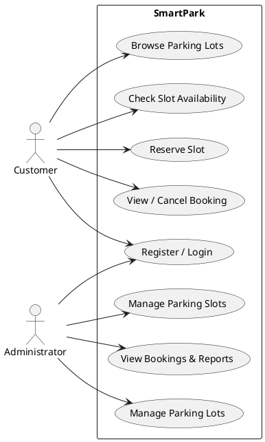
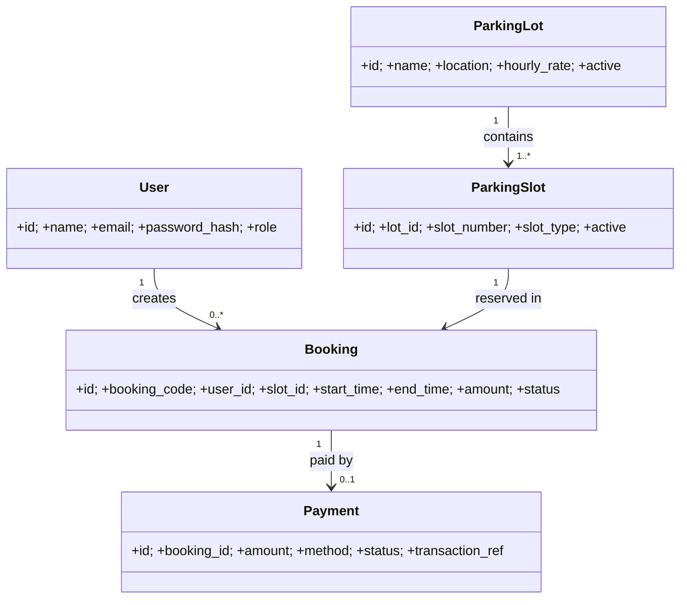
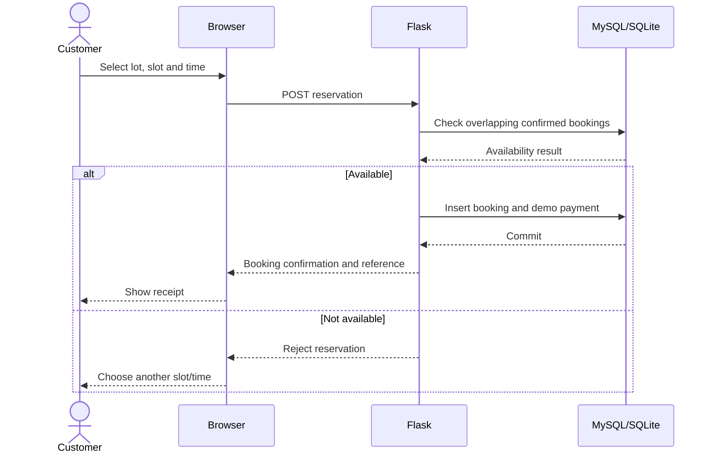
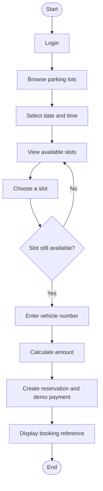

# UML Design — Smart Parking Reservation System

## Use Case Diagram (PlantUML)


## Class Diagram (Mermaid)


## Sequence Diagram — Reservation


## Activity Diagram — Booking


## ER Diagram
```mermaid
erDiagram
USER ||--o{ BOOKING : creates
PARKING_LOT ||--|{ PARKING_SLOT : contains
PARKING_SLOT ||--o{ BOOKING : receives
BOOKING ||--o| PAYMENT : has
USER { int id PK; string name; string email UK; string password_hash; string role }
PARKING_LOT { int id PK; string name; string location; float hourly_rate }
PARKING_SLOT { int id PK; int lot_id FK; string slot_number; string slot_type; boolean active }
BOOKING { int id PK; string booking_code UK; int user_id FK; int slot_id FK; datetime start_time; datetime end_time; float amount; string status }
PAYMENT { int id PK; int booking_id FK; float amount; string method; string status; string transaction_ref UK }
```
